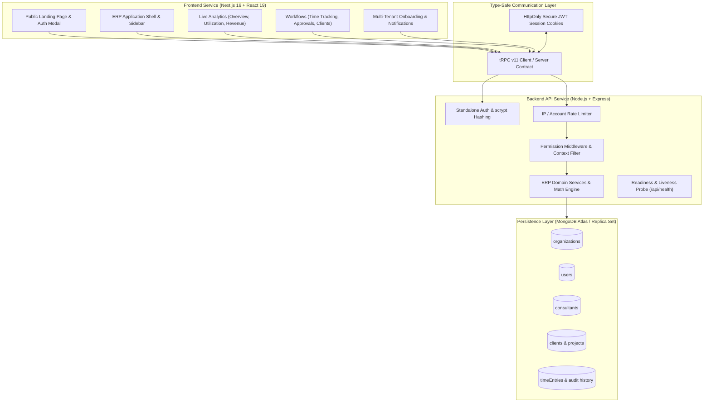

# NEXCORE — Consultant Operations, Resource Utilization & Revenue Analytics Platform

[](https://www.typescriptlang.org/)
[-black.svg)](https://nextjs.org/)
[](https://react.dev/)
[](https://nodejs.org/)
[](https://trpc.io/)
[](https://www.mongodb.com/)
[](https://tailwindcss.com/)
[](LICENSE)

NEXCORE is an enterprise-grade ERP platform designed for modern professional services, management consultancies, and digital agencies. It centralizes practitioner capacity planning, time tracking, billable utilization analytics, and multi-currency revenue forecasting into a unified, multi-tenant workspace with server-enforced role-based access control (RBAC).

---

## Table of Contents

- [Architectural Overview](#-architectural-overview)
- [Key Features & Modules](#-key-features--modules)
- [Security & Authentication](#-security--authentication)
- [Role-Based Access Control (RBAC)](#-role-based-access-control-rbac)
- [Tech Stack](#-tech-stack)
- [Repository Structure](#-repository-structure)
- [Getting Started](#-getting-started)
  - [Prerequisites](#prerequisites)
  - [Environment Setup](#environment-setup)
  - [Database Indexing & Seeding](#database-indexing--seeding)
  - [Running Development Servers](#running-development-servers)
- [Production Build & Deployment](#-production-build--deployment)
- [Testing & Quality Assurance](#-testing--quality-assurance)
- [Operational Disclosures](#-operational-disclosures)

---

## 🏛️ Architectural Overview

NEXCORE is structured as a decoupled monorepo featuring a Next.js frontend client and an Express/tRPC backend API engine, backed by a persistent MongoDB cluster.



---

## 🌟 Key Features & Modules

### 1. Public Landing Page & Bootstrap System
- **Enterprise Deep-Navy Aesthetic**: Hero section, interactive ROI utilization calculator, feature spotlights, and value proposition cards.
- **First-Admin Bootstrap**: Safe zero-administrative state detection. When a database contains no admin accounts, the system securely allows the first operator to provision the initial superadmin, automatically locking the endpoint once created.

### 2. Multi-Tenant Organization Isolation
- **Organization Workspaces**: Complete data boundary isolation per organization.
- **Employee Onboarding Gateway**: Dedicated self-service onboarding flow (`/onboarding`) enabling consultants and staff to request access to their company workspace.
- **Admin Approval Queue**: Pending approval gatekeeper (`/pending-approval`) paired with an administrative Notification Center to approve or reject employee join requests.

### 3. Executive Overview Dashboard
- **Real-Time KPI Cards**: Active Consultants, Available Hours, Billable Hours, Non-Billable Hours, Average Utilization %, and Estimated Billable Revenue.
- **Target Utilization Reference**: Direct visualization comparing team output against the 75% target threshold.
- **Currency-Segregated Revenue**: Real-time revenue charts that strictly separate `USD`, `EUR`, and `GBP` to prevent invalid multi-currency additions.
- **Consultant Performance Table**: Searchable, filterable practitioner table showing individual hour allocations, revenue generation, and billing status.

### 4. Consultant Capacity & Profile Management
- **Practitioner Directory**: Full management of employee codes, departments, titles, standard weekly capacity hours, and hourly billing rates.
- **Record-Level Scoping**: Consultants can view only their own assigned records, while managers and admins manage the entire directory.
- **Deactivation Protection**: Restricts destructive deletions, using non-destructive deactivation to preserve historical timesheet integrity.

### 5. Time Tracking & Approval Lifecycle
- **Complete State Machine**: Robust `Draft` ➔ `Submitted` ➔ `Approved` / `Rejected` ➔ `Draft` workflow.
- **Self-Approval Prohibition**: Managers and administrators are strictly blocked by backend validation from approving or rejecting their own timesheet submissions.
- **Rate Snapshotting**: Automatically snapshots client hourly rates and billing currencies upon billable entry creation, protecting historical financial figures from future rate changes.
- **Optimistic Locking & Audit Trail**: Full approval history recording reviewer ID, previous status, timestamp, and rejection reasons.

### 6. Utilization Analytics Engine
- **Capacity Calculations**: Business-day capacity computation with automatic zero-capacity division guards.
- **Capacity Load Tiers**: Classifies consultant workload into standard operational brackets:
  - `Over Capacity` (> 100%)
  - `Target Band` (70% – 90%)
  - `Underutilized` (< 70%)
  - `No Capacity` (0 hrs configured)

### 7. Revenue Analytics & Financial Privacy
- **Strict Role Gating**: Requires the explicit `metrics.financial` permission. Unauthorized users receive HTTP 403 Forbidden with all financial outputs scrubbed from API payloads.
- **Transaction-Level Audit**: Detailed revenue ledger breaking down project billing, rates, and margins without cross-currency mathematical pollution.

### 8. Clients, Projects & Retainers
- **Client & Project Hierarchy**: Client code uniqueness enforcement, status toggles, and project association.
- **Retainer Tracking**: Active retainer monitoring displaying approved billable hours delivered against client budget envelopes.

### 9. Operational Alerts & CSV Reports
- **Deterministic Action Queue**: Real-time alerts generated from live operational criteria: unapproved timesheets older than 7 days, overdue draft submissions, and capacity overload.
- **RFC-Compliant Data Exports**: 4 standard exportable reports (Utilization Summary, Consultant Time Detail, Project Revenue Breakdown, and Client Audit) with CSV export capability.

---

## 🔒 Security & Authentication

NEXCORE implements defense-in-depth security principles across authentication, session handling, and authorization:

- **NIST-Grade Password Hashing**: Standalone password storage powered by Node.js native `crypto.scrypt` with a cryptographically secure 16-byte random salt per user and constant-time buffer comparison (`timingSafeEqual`) to prevent timing attacks.
- **JWT Session Security**: Compact HS256 tokens signed via `jose`, delivered via `HttpOnly`, `SameSite=lax` (or `strict`), and HTTPS `Secure` cookies. Session payloads are verified and refreshed against the live database on privileged operations.
- **Brute-Force Rate Limiting**: In-memory rate limiting restricting failed authentication attempts (max 5 failures per 5 minutes per IP/email) with constant-time generic responses to prevent username enumeration.
- **Account Disablement Invalidation**: Suspended accounts (`status: "disabled"`) are rejected immediately at login and have existing cookie sessions rejected on the next API call.
- **Anti-Lockout Safeguards**: Administrators cannot demote their own role or deactivate their own user account.

---

## 🛡️ Role-Based Access Control (RBAC)

NEXCORE enforces a 5-tier role hierarchy validated in server-side tRPC middleware:

| Permission | Admin | Manager | Finance | Consultant | Unassigned User |
| :--- | :---: | :---: | :---: | :---: | :---: |
| `consultants.read` | ✅ Full | ✅ Full | ✅ Full | 🔒 Self Only | ❌ |
| `consultants.manage` | ✅ Full | ✅ Full | ❌ | ❌ | ❌ |
| `clients.read` | ✅ Full | ✅ Full | ✅ Full | ❌ | ❌ |
| `clients.manage` | ✅ Full | ✅ Full | ✅ Full | ❌ | ❌ |
| `projects.read` | ✅ Full | ✅ Full | ✅ Full | ❌ | ❌ |
| `projects.manage` | ✅ Full | ✅ Full | ✅ Full | ❌ | ❌ |
| `time.read` | ✅ Full | ✅ Full | ✅ Full | 🔒 Self Only | ❌ |
| `time.write` (Create/Edit) | ✅ Full | ✅ Full | ❌ | 🔒 Self Only | ❌ |
| `time.submit` | ✅ Full | ✅ Full | ❌ | 🔒 Self Only | ❌ |
| `time.approve` / `reject` | ✅ Full | 🔒 Non-Self | ❌ | ❌ | ❌ |
| `metrics.utilization` | ✅ Full | ✅ Full | ✅ Full | 🔒 Self Only | ❌ |
| `metrics.financial` (Revenue) | ✅ Full | ❌ | ✅ Full | ❌ | ❌ |
| `users.manage` | ✅ Full | ❌ | ❌ | ❌ | ❌ |

---

## 💻 Tech Stack

### Frontend Architecture
- **Framework**: Next.js 16 (App Router + Turbopack) & React 19
- **Language**: TypeScript 5.x (Strict Mode)
- **Styling**: Tailwind CSS, PostCSS, Radix UI Primitives, Lucide Icons
- **Data Visualization**: Recharts (Responsive SVG Charts)
- **Client Routing & API**: Wouter & TanStack React Query + `@trpc/client`

### Backend Architecture
- **Runtime**: Node.js (v20+ LTS recommended)
- **Framework**: Express.js with `@trpc/server/adapters/express`
- **Validation**: Zod (Schema-level request and domain validation)
- **Cryptography**: Native `node:crypto` (scrypt, randomBytes, timingSafeEqual)
- **Sessions & JWT**: `jose` (Compact HS256 tokens)
- **Database Driver**: Official MongoDB Node.js Driver v7

### Testing & Tooling
- **Test Runner**: Vitest (Unit & Acceptance Testing)
- **Bundler**: esbuild (High-speed backend production build)
- **Package Manager**: pnpm / npm

---

## 📁 Repository Structure

```text
nexcore/
├── package.json                    # Monorepo root scripts & dev dependencies
├── pnpm-workspace.yaml             # pnpm workspace definition
├── tsconfig.json                   # Base TypeScript compiler options
├── vitest.config.ts                # Root Vitest runner configuration
├── .gitignore                      # Git exclusion rules (secrets, builds, temp)
├── .env.example                    # Root environment configuration template
├── DEPLOYMENT.md                   # Production deployment runbook & operations guide
├── README.md                       # Comprehensive platform documentation
│
├── frontend/                       # Next.js 16 Frontend Application
│   ├── app/                        # Next.js App Router (layout, catch-all bridge)
│   ├── src/
│   │   ├── components/             # Reusable UI primitives, AppShell, Dialogs
│   │   ├── contexts/               # AuthContext, ThemeContext
│   │   ├── hooks/                  # Custom composition & responsive hooks
│   │   ├── lib/                    # Client services, tRPC client, calculations
│   │   ├── views/                  # Core modules (Landing, Home, Utilization, etc.)
│   │   ├── App.tsx                 # Client application root & route mapping
│   │   └── index.css               # Design tokens, CSS variables, dark theme
│   ├── package.json                # Frontend dependencies & Next.js scripts
│   └── tsconfig.json               # Frontend TypeScript configuration
│
└── backend/                        # Node.js Express & tRPC API Service
    ├── src/
    │   ├── _core/                  # Cookies, environment, tRPC context & router
    │   ├── authorization.ts        # RBAC permissions matrix & tRPC middleware
    │   ├── calculations.ts         # Utilization & revenue computation engine
    │   ├── createIndexes.ts        # MongoDB unique & compound index definitions
    │   ├── db.ts                   # User & organization multi-tenant persistence
    │   ├── erpDb.ts                # Consultant, project, & time tracking logic
    │   ├── index.ts                # Express server entry point & CORS configuration
    │   ├── mongo.ts                # MongoDB client singleton & connection pool
    │   ├── password.ts             # NIST-grade scrypt hashing & verification
    │   ├── rateLimiter.ts          # Authentication brute-force protection
    │   ├── routers.ts              # tRPC API procedure definitions
    │   ├── seedOrganizations.ts    # Multi-tenant test organization seeder
    │   ├── seedTestUsers.ts        # Role-based test account seeder
    │   └── types.ts                # Shared TypeScript schemas & domain types
    ├── package.json                # Backend dependencies & scripts
    └── tsconfig.json               # Backend TypeScript configuration
```

---

## 🚀 Getting Started

### Prerequisites

- **Node.js**: `v20.0.0` or higher
- **Package Manager**: `npm` (v10+) or `pnpm` (v9+)
- **MongoDB**: A running MongoDB instance (Local standalone or MongoDB Atlas replica set)

### Environment Setup

1. **Clone the repository**:
   ```bash
   git clone https://github.com/abhishekpathak17052005/Nexcore.git
   cd Nexcore
   ```

2. **Configure Backend Environment**:
   Create a `.env` file in the `backend/` directory:
   ```bash
   cp backend/.env.example backend/.env
   ```
   Populate `backend/.env`:
   ```env
   PORT=5000
   MONGODB_URI=mongodb://127.0.0.1:27017
   MONGODB_DB_NAME=consultant_utilization_dashboard
   SESSION_SECRET=replace_with_a_secure_32_character_random_string
   APP_ID=nexcore-app
   COOKIE_SAME_SITE=lax
   COOKIE_SECURE=false
   ```

3. **Install Dependencies**:
   ```bash
   npm install
   ```

### Database Indexing & Seeding

1. **Build Database Indexes**:
   Create unique indexes (`employeeCode`, `email`, `clientCode`) and compound query indexes:
   ```bash
   npm run db:indexes
   ```

2. **Seed Local Development Data (Optional)**:
   Seed multi-tenant sample organizations and test practitioners:
   ```bash
   cd backend
   npx tsx src/seedOrganizations.ts
   npx tsx src/seedTestUsers.ts
   cd ..
   ```

### Running Development Servers

Start both backend and frontend concurrently:

```bash
# Terminal 1: Backend API Service (Port 5000)
npm run dev:backend

# Terminal 2: Frontend Client (Port 3000)
npm run dev:frontend
```

Open [http://localhost:3000](http://localhost:3000) in your browser.

---

## 📦 Production Build & Deployment

For full deployment instructions, SSL/cookie security, and health monitoring, consult [`DEPLOYMENT.md`](DEPLOYMENT.md).

```bash
# 1. Typecheck both packages
npm run check:backend
npm run check:frontend

# 2. Compile production bundles
npm run build:backend
npm run build:frontend

# 3. Launch production services
cd backend && npm start   # Serves Express API on configured PORT
cd frontend && npm start  # Serves Next.js on port 3000
```

---

## 🧪 Testing & Quality Assurance

NEXCORE maintains automated test suites covering data validation, RBAC security, standalone authentication, and end-to-end acceptance workflows:

```bash
# Run unit & security test suite
npm test

# Run specific test suites
cd backend
npx vitest run src/authorization.test.ts   # RBAC permission matrix verification
npx vitest run src/auth.standalone.test.ts  # scrypt password hashing & session tests
npx vitest run src/erpDb.validation.test.ts # Business logic & numeric bounds tests
```

---

## ⚠️ Operational Disclosures

- **Multi-Document Transactions**: Multi-document transactions between time-entry status updates and approval history entries require a MongoDB replica set or MongoDB Atlas cluster. When developing on standalone MongoDB, a single-document fallback is used.
- **Invoicing & Ledger Integration**: NEXCORE calculates estimated billable revenue based on approved timesheets and captured hourly rates. Formal invoicing, tax handling, and accounts receivable reconciliation should be connected to external accounting platforms (NetSuite, QuickBooks, Xero).
- **Password Recovery**: Self-service email password recovery requires integration with an approved SMTP/SES transactional email service provider.

---

## 📄 License

This project is licensed under the MIT License — see the [LICENSE](LICENSE) file for details.
