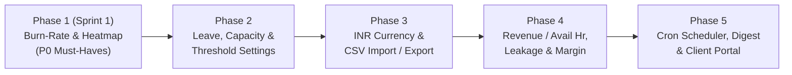

# Nexcore — Backend Review & Roadmap

**Codebase Audit, Security Analysis, PRD Gap Matrix & Implementation Roadmap**  
*Document Date:* November 2026 · *Target System:* Nexcore Professional Services Backend  
*Status:* Corrected Technical Review for Alignment with Rajesh (Kept separate from functional PRD)

---

## Document Purpose & Context

This document captures the technical code audit and implementation gap assessment of the **Nexcore** backend zip archive. It serves as an engineering alignment reference for Rajesh and the engineering team, clarifying:
- What is currently built and verified in the codebase.
- Technical corrections regarding framework, database driver, authentication SDK, and role structures.
- High-priority security and configuration vulnerabilities requiring remediation.
- Direct mapping of PRD requirements (**Must**, **Should**, **Nice**, **Non-goal**) to engineering sprint priorities (**P0 – P3**).
- Concrete code implementations for session revocation adapted to the native `mongodb` + `jose` stack.

---

## 1. Architecture Overview

| Layer / Concern | Actual Implementation in Nexcore Codebase |
|---|---|
| **Runtime & Framework** | **Express + tRPC + TypeScript** (end-to-end type-safe procedures) |
| **Database Layer** | **Native `mongodb` driver (v7)**. Mongoose is *not* used or installed. |
| **Authentication** | Session cookies using **`jose`** JWTs in `src/_core/sdk.ts` signed with `SESSION_SECRET`. |
| **Roles (RBAC)** | **5 roles:** `admin`, `manager`, `finance`, `consultant`, and `user` (unassigned). *(No super_admin or viewer roles).* |
| **Tenancy** | Organization-scoped data scoping across documents. |
| **Rate Limiting** | Persistent tracking collection in MongoDB (functions across multiple horizontally scaled instances). |
| **Email Service** | Transactional SMTP via `nodemailer`. |
| **Security & Access Control** | Origin verification with CORS allowlist; procedure guards; financial data redaction helper. |
| **Test Coverage** | **~14 test files, ~125 test cases** *(grep estimate from zip; unexecuted due to sandbox network constraints)*. |

> [!NOTE]
> **Financial Redaction Architecture:**  
> Financial redaction is implemented as a specialized helper function (`redactFinancialValues`), **not** generic Express middleware. It strips billing rates, cost rates, margins, and revenue from any user role lacking the `metrics.financial` permission. This hides money values from consultants, unassigned users, and managers who lack financial permissions, while leaving them fully visible to `finance` and `admin`. Hours and utilization ratios remain unredacted.

---

## 2. What's Built ✅

| Feature / Area | Implementation Notes in Nexcore Backend |
|---|---|
| **Authentication** | Signup (no email verification), login, logout (clears cookie), password reset via emailed token link, and password change with a 6-digit verification code. |
| **Authorization & RBAC** | 5 roles (`admin`, `manager`, `finance`, `consultant`, `user`) with permission checks on tRPC procedures, organization scoping, and an admin approval flow for newly registered accounts. |
| **Rate-Limited Login** | Failed attempt tracking stored in MongoDB — persists across server restarts and works across clustered instances. |
| **Consultants** | Create, read, update, and deactivation toggle (no hard deletion modeled). |
| **Clients** | Create, read, and update (no deletion modeled). |
| **Projects** | Create, read, and update with consultant team assignments (no deletion modeled). |
| **Time Entries** | Submit, manager approval/rejection workflow; billing rate snapshot saved at entry creation time. |
| **Utilization & Revenue** | Overall aggregate utilization percentage and baseline revenue figures (no per-week grouping yet). |
| **Retainers & Standard Alerts** | Usage tracking with four standard alert types: *threshold*, *exceeded*, *expiring*, and *expired*. |
| **Financial Redaction** | `redactFinancialValues` helper scrubs monetary values for roles without `metrics.financial`. |
| **Attendance & Live Presence** | Consultant sign-in / sign-out timestamps and active presence queries *(feature built beyond original PRD scope)*. |
| **Transactional Email** | SMTP transport integration via `nodemailer`. |
| **CORS Hardening** | Origin check against configured allowlist. |
| **Demo Data Seed** | Seed script to populate demo organizations, users, and consultant profiles. |

---

## 3. Security & Configuration Issues ⚠️

> [!CAUTION]
> **Issues 1, 2, and 5 are High severity.** Because the project zip contained live environment values, secret rotation for Issue 5 must be performed immediately.

| # | Issue | Severity | Findings & Recommended Remediation |
|---|---|---|---|
| 1 | **Irrevocable Long-Lived Sessions** | 🔴 **High** | Session tokens in `src/_core/sdk.ts` use `ONE_YEAR_MS` (~365 days). Logout only clears the client cookie; the token remains cryptographically valid.<br>**Fix:** Shorten lifetime to 24h, add `sessionVersion` to the user document, and invalidate existing tokens on password reset/change. |
| 2 | **Unrestricted Signup Procedure** | 🔴 **High** | The `auth.signup` tRPC procedure enforces no rate limiting or email verification. Anyone can programmatically create organizations and accounts.<br>**Fix:** Add rate limiting to `auth.signup` and require email confirmation before account activation. |
| 3 | **Missing `trust proxy` Setting** | 🟡 **Medium** | Behind a reverse proxy or load balancer, `req.ip` resolves to the proxy IP, grouping all incoming requests into one rate-limit bucket.<br>**Fix:** Add `app.set('trust proxy', 1)` in `index.ts`. |
| 4 | **Oversized JSON Body Limit** | 🟡 **Medium** | `express.json({ limit: '50mb' })` in `index.ts` leaves the server vulnerable to memory exhaustion / DoS attacks.<br>**Fix:** Lower the global JSON body limit to 1–2 MB. |
| 5 | **Exposed Secrets in Repo Archive** | 🔴 **High** | The zip archive bundled `backend/.env` and `dist/` containing real secrets (session keys, database strings).<br>**Fix:** **Immediately rotate all exposed credentials**, and exclude `.env` and `dist/` via `git archive` or `.gitignore`. |

---

## 4. Feature Gap Analysis — PRD vs Built

| Feature / Requirement | PRD Requirement | Current Status | Sprint Priority |
|---|---|---|---|
| Retainer pacing, daily burn, projected run-out date, burn-rate alert | **Must** | 🔴 Missing | **P0** |
| Heatmap data (consultants × week matrix) | **Must** | 🔴 Missing | **P0** |
| Per-week utilization breakdown | **Must** | 🟡 Partial (overall only) | **P1** |
| Revenue per available hour | **Must** | 🔴 Missing | **P1** |
| Capacity check against real availability | **Must** | 🔴 Missing | **P1** |
| Leave and public holidays tracking | **Must** | 🔴 Missing (capacity overstated) | **P1** |
| Configurable utilization thresholds (settings API) | **Must** | 🔴 Missing (hardcoded) | **P1** |
| Scope leakage & out-of-scope flag tracking | **Should** | 🔴 Missing | **P1** |
| INR currency support | **Should** | 🔴 Missing (USD/EUR/GBP only) | **P2** |
| CSV data import (consultants/time entries) | **Should** | 🔴 Missing | **P2** |
| CSV reports and formula drill-down | **Should** | 🔴 Missing | **P2** |
| Cost rate and profit margin analytics | **Nice** | 🔴 Missing | **P2** |
| Weekly automated email digest | **Nice** | 🔴 Missing (no scheduler) | **P2** |
| Read-only client portal link | **Nice** | 🔴 Missing | **P3** |
| Subscription plans, seats, and billing payments | **Non-goal** | ⚪ Out of Scope | **P3** |

---

## 5. Infrastructure & Cleanup

| Area | Required Action & Architectural Rationale |
|---|---|
| **Scheduler Infrastructure** | Deploy an in-process cron engine (e.g. `node-cron`) or job runner to automate weekly digest dispatches and daily retainer burn-rate evaluations. |
| **MongoDB Replica Set** | Required in production for multi-document transaction support (standard on MongoDB Atlas; verify local/staging replica set configuration). |
| **Email Domain Verification** | Ensure SPF, DKIM, and DMARC DNS records are verified with the mail sending provider (Resend/SMTP) to avoid spam filtering of password reset links. |
| **Template Code Removal** | Verify whether unused scaffolding modules in `_core` (LLM, map, image, voice, heartbeat) can be deleted to minimize attack surface and binary size. |
| **Frontend Wiring** | Connect frontend UI views to newly exposed tRPC procedures as backend modules are delivered. |

---

## 6. Implementation Roadmap



### Phase 1 — Immediate Focus (P0 Core Gaps)
1. **Retainer burn-rate and pacing engine:** Daily consumption tracking, projected depletion dates, overage metrics, and the 5th alert type (`burn_rate`).
2. **Heatmap data endpoint:** Consultants × week matrix for visual capacity and utilization management.

### Phase 2 — Availability & Configuration (P1 Gaps)
3. **Leave and public holidays data model:** Record approved time off and company holidays so available capacity is accurate rather than overstated. *(Note: External calendar sync is an optional future enhancement beyond PRD scope).*
4. **Accurate capacity calculation:** Base working days minus approved leave minus holidays × standard hours.
5. **Settings API for utilization thresholds:** Replace hardcoded targets with configurable organization-level warning and critical thresholds.

### Phase 3 — Localization & Data Portability (P2 Gaps)
6. **INR currency support:** Extend currency enum and formatting helpers to support Indian Rupee alongside USD, EUR, and GBP.
7. **CSV data import:** Bulk onboarding for consultants, client accounts, and historical time records.
8. **CSV report export:** Detailed billing exports including calculated rate snapshots and formula drill-down columns.

### Phase 4 — Advanced Analytics (P1–P2 Gaps)
9. **Revenue per available hour metric:** PRD-mandated efficiency formula (Total Revenue ÷ Total Available Capacity).
10. **Scope leakage tracking:** `isOutOfScope` flag handling on time entries to quantify unbilled consulting effort.
11. **Cost rate and margin analysis:** Gross profit and margin percentages computed from consultant hourly cost baselines.

### Phase 5 — Automation & External Sharing (P2–P3 Gaps)
12. **Background scheduler infrastructure:** Configure robust cron runner for scheduled background tasks.
13. **Weekly executive email digest:** Automated operational summary emailed to managers and administrators on Mondays.
14. **Read-only client portal:** Secure, tokenized share links enabling external clients to view real-time retainer burn and project status.

---

## 7. Session Security Fix — Code Implementation

> [!WARNING]
> **Architecture Alignment:**  
> Nexcore does not use Mongoose, Express controller files, or `jsonwebtoken`. Authentication is powered by **`jose`** in `src/_core/sdk.ts` using `SESSION_SECRET`, with database operations handled through the native MongoDB driver in `db.ts`. Because the authentication flow already reads the user record on each incoming request, adding session versioning requires no Redis dependency and no external cache.

### Step 1: Add `sessionVersion` field to User document
Ensure new user documents default to `sessionVersion: 0`. Backfill existing documents in MongoDB:
```typescript
// MongoDB native driver migration (run once)
await db.collection("users").updateMany(
  { sessionVersion: { $exists: false } },
  { $set: { sessionVersion: 0 } }
);
```

### Step 2: Update token creation and lifetime in `src/_core/sdk.ts`
Shorten token duration from 1 year to 24 hours, and include `sessionVersion` in the JWT payload:
```typescript
import * as jose from "jose";

// Replace ONE_YEAR_MS with 24 hours
const SESSION_EXPIRATION_MS = 24 * 60 * 60 * 1000; // 24 hours (was ONE_YEAR_MS)

export async function createSessionToken(user: User): Promise<string> {
  const secret = new TextEncoder().encode(process.env.SESSION_SECRET);
  return new jose.SignJWT({
    userId: user._id.toString(),
    organizationId: user.organizationId?.toString(),
    role: user.role,
    sessionVersion: user.sessionVersion ?? 0,
  })
    .setProtectedHeader({ alg: "HS256" })
    .setIssuedAt()
    .setExpirationTime(Date.now() + SESSION_EXPIRATION_MS)
    .sign(secret);
}
```

### Step 3: Validate `sessionVersion` in `authenticateRequest` (`src/_core/sdk.ts`)
Compare the token's claim against the database user's current version:
```typescript
export async function authenticateRequest(req: Request): Promise<User | null> {
  const token = extractTokenFromCookieOrHeader(req);
  if (!token) return null;

  try {
    const secret = new TextEncoder().encode(process.env.SESSION_SECRET);
    const { payload } = await jose.jwtVerify(token, secret);

    const user = await db.collection("users").findOne({ _id: new ObjectId(payload.userId as string) });
    if (!user) return null;

    // Immediately reject requests where sessionVersion doesn't match
    if (payload.sessionVersion !== (user.sessionVersion ?? 0)) {
      return null; // Forces 401 Unauthorized / redirects to login
    }

    return user;
  } catch (err) {
    return null;
  }
}
```

### Step 4: Increment `sessionVersion` upon Password Changes (`db.ts`)
In `db.ts`, update `consumePasswordReset` and `consumePasswordResetForUser` to increment `sessionVersion`:
```typescript
// In db.ts -> consumePasswordReset & consumePasswordResetForUser
export async function consumePasswordReset(token: string, newPasswordHash: string) {
  return db.collection("users").findOneAndUpdate(
    { resetToken: token, resetExpires: { $gt: new Date() } },
    {
      $set: { passwordHash: newPasswordHash, resetToken: null, resetExpires: null },
      $inc: { sessionVersion: 1 } // Instantly invalidates all outstanding sessions on all devices
    },
    { returnDocument: "after" }
  );
}
```
